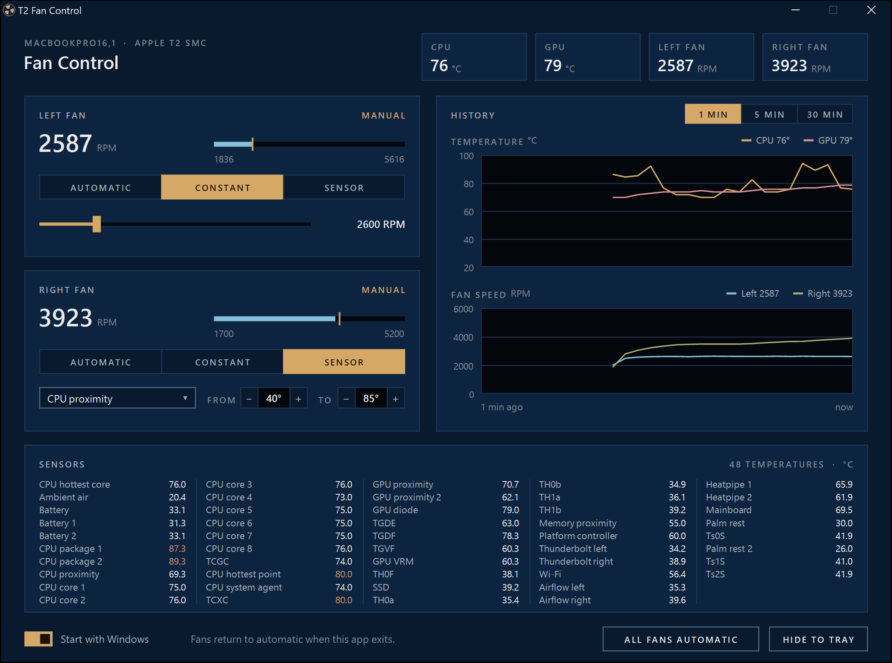

# T2 Fan Control

A small Windows tray app that monitors and controls the fans on Intel Macs with
the Apple T2 chip when they are booted into Windows (Boot Camp).



- **Per-fan control:** Automatic, a constant speed, or a speed that follows any
  temperature sensor between two temperatures you choose.
- **Live history:** temperature (CPU, GPU) and fan speed graphs over the last
  1, 5 or 30 minutes.
- **Every sensor:** all temperature sensors the SMC reports, in one grid.
- **Tray icon:** shows the CPU temperature; starts with Windows if you want.
- **No administrator rights** needed to run, and no installer: one small
  `.exe`, built from three C# files with the compiler that ships with Windows.

> **Status: early, tested on one machine.** It has been built and tested on a
> single MacBookPro16,1 (16-inch, 2019) running Windows 11. Other T2 Macs
> should work but are unverified. Please read [Safety](#safety) before using
> it, and open an issue with what you find.

## Requirements

| Requirement | Notes |
|---|---|
| An Intel Mac with the T2 chip, booted into Windows 10/11 x64 | 2018–2020 MacBook Pro/Air, iMac 2020, iMac Pro, Mac mini 2018, Mac Pro 2019. Pre-T2 Macs use a different SMC interface and are **not** supported. |
| The `inpoutx64` kernel driver, installed and running | See below. |
| .NET Framework 4.x | Included with Windows 10 and 11. |

### The inpoutx64 driver

Windows does not let ordinary programs talk to hardware, so the app reaches the
SMC through the third-party **InpOut32/InpOutx64** driver
(<https://www.highrez.co.uk/downloads/inpout32/>).

- If you have ever installed **Macs Fan Control**, the driver is probably
  already present. Check with:

  ```powershell
  Get-CimInstance Win32_SystemDriver -Filter "Name='inpoutx64'"
  ```

  You want `State: Running`.
- Otherwise download the "binaries only" package from the link above and run
  its `InstallDriver.exe` once, as Administrator.

Read the [Safety](#safety) section about what this driver allows.

## Build

No SDK or Visual Studio needed. From a PowerShell prompt in the repository:

```powershell
.\build.ps1
```

This produces `build\T2FanControl.exe` using the C# compiler included with
Windows (`%WINDIR%\Microsoft.NET\Framework64\v4.0.30319\csc.exe`).

To build, copy the app to `%LOCALAPPDATA%\Programs\T2FanControl`, register it
to start with Windows and launch it:

```powershell
.\build.ps1 -Install
```

If PowerShell refuses to run the script, use
`powershell -ExecutionPolicy Bypass -File .\build.ps1`.

## Using it

Run `T2FanControl.exe`. Closing the window hides it to the tray; use the tray
icon's menu to exit.

| Mode | What it does |
|---|---|
| **Automatic** | The Mac's own thermal management controls the fan. |
| **Constant** | Holds the speed you set with the slider (within the fan's own min–max range). |
| **Sensor** | Speed rises in a straight line from the fan's minimum at the **From** temperature to its maximum at the **To** temperature, following the sensor you pick. "CPU hottest core" is the highest of the per-core sensors. |

Command line:

| Argument | Effect |
|---|---|
| `--tray` | Start hidden in the tray (used by the startup entry). |
| `--exit` | Ask the running copy to quit cleanly, returning fans to automatic. |

Settings are stored in `%APPDATA%\T2FanControl\settings.txt`. "Start with
Windows" writes a per-user entry under
`HKCU\Software\Microsoft\Windows\CurrentVersion\Run`.

## Safety

This program changes how your computer cools itself. Use it at your own risk.

- **Don't run it alongside Macs Fan Control** (or any other fan tool). Two
  programs talking to the SMC at once corrupt each other's transactions. The
  app detects a running `MacsFanControl.exe` and switches to monitor-only until
  it is closed.
- **Fans return to automatic** when the app exits normally, when Windows shuts
  down, and when a sensor used for control stops reading. If the app is
  **force-killed**, a fan in manual mode stays at its last speed until you
  start the app again or reboot.
- **A low constant speed under heavy load will let the machine run hot.** The
  Mac still protects itself by throttling and, in the worst case, shutting
  down, but nothing in this app stops you choosing a poor setting.
- **The app only ever writes two kinds of SMC key**, the per-fan manual-mode
  flag (`F?Md`) and target speed (`F?Tg`). The code refuses anything else.
- **The inpoutx64 driver is a broad capability.** It lets programs read and
  write I/O ports and map physical memory. On the test machine its device could
  be opened by a non-administrator process, which is what lets this app run
  without elevation, and equally lets any other program on the machine use it.
  Windows' Memory Integrity (Core Isolation) may block the driver. Decide for
  yourself whether you are comfortable having it installed.

## Known limitations

- Tested on one MacBookPro16,1 only.
- The SMC's memory address (`0xFE0B0000`) is hard-coded. It matches the ACPI
  resource of the `APP0001` device on the test machine and on machines reported
  elsewhere, but it is not read from ACPI at run time. If the address differs
  the app reports an error at start and does nothing.
- Sleep/wake has not been tested. The app re-applies settings on resume, in
  theory.
- Some sensor names are best guesses; unknown sensors are shown by their raw
  SMC key. Corrections are welcome.
- The window shows controls for the first two fans only (history and tiles
  handle up to four).
- No code signing.

## How it works

See [docs/how-it-works.md](docs/how-it-works.md) for the SMC protocol, the key
list and the control loop, and
[docs/troubleshooting.md](docs/troubleshooting.md) if something does not work.

## Contributing

Bug reports from other T2 models are the most useful thing right now. See
[CONTRIBUTING.md](CONTRIBUTING.md).

## Credits

- The T2 memory-mapped SMC protocol follows the Linux `applesmc` driver and the
  t2linux project's T2 patches.
- [RPMAC](https://github.com/golirt1/RPMAC) documented the same protocol for
  Windows and the `Global\AppleSmcAccess` mutex convention this app honours.
- [InpOut32/InpOutx64](https://www.highrez.co.uk/downloads/inpout32/) provides
  the kernel driver.

This project is not affiliated with Apple or with Macs Fan Control.

## Licence

[MIT](LICENSE)
